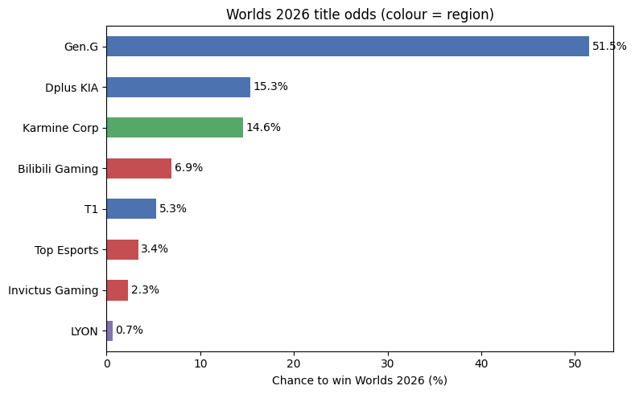
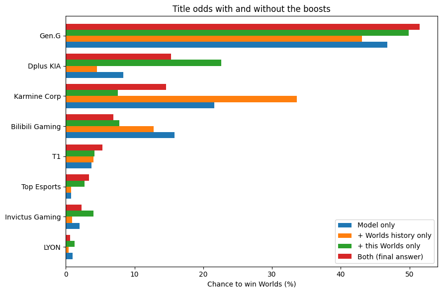
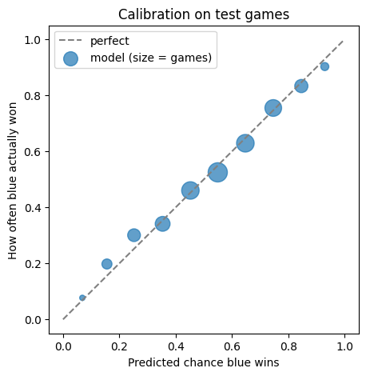
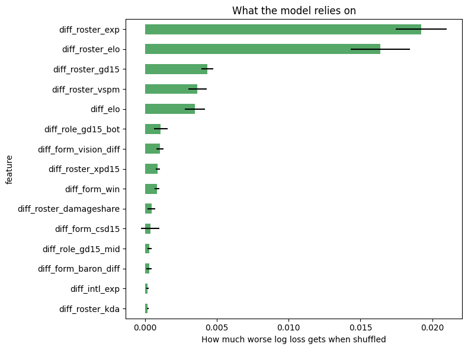

# Worlds 2026 Winner Predictor

A machine-learning pipeline that estimates each team's probability of winning the **2026 League of Legends World Championship**. It learns game outcomes from three seasons of professional match data, then simulates the knockout bracket 20,000 times.

[](https://colab.research.google.com/github/argyroselene/worlds2026-predictor/blob/main/notebooks/worlds2026_predictor.ipynb)

## Results (after the Swiss stage, 2026-11-01)

| Team | Swiss | Win QF | Reach final | **Win Worlds** | Model only |
|---|:-:|:-:|:-:|:-:|:-:|
| Gen.G | 3-0 | 92.6% | 78.2% | **51.5%** | 46.8% |
| Dplus KIA | 3-0 | 59.8% | 33.7% | **15.3%** | 8.4% |
| Karmine Corp | 3-2 | 62.2% | 33.2% | **14.6%** | 21.6% |
| Bilibili Gaming | 3-2 | 40.2% | 17.7% | **6.9%** | 15.8% |
| T1 | 3-1 | 37.8% | 15.4% | **5.3%** | 3.7% |
| Top Esports | 3-1 | 53.3% | 9.9% | **3.4%** | 0.8% |
| Invictus Gaming | 3-1 | 46.7% | 8.6% | **2.3%** | 2.0% |
| LYON | 3-2 | 7.4% | 3.3% | **0.6%** | 1.0% |

*Model only* excludes the two tournament adjustments described below. Bracket: DK vs BLG and T1 vs KC meet in one semifinal, TES vs IG and Gen.G vs LYON in the other. Most likely final: Gen.G vs DK (26.3%) or Gen.G vs KC (26.2%).

<p align="center">
  
  
</p>

Data covers 30,006 games (2024-01-01 to 2026-10-22). Full outputs are in the [notebook](notebooks/worlds2026_predictor.ipynb).

## Method

### 1. Data
[Oracle's Elixir](https://oracleselixir.com) match data: one row per player and two team rows per game. The pipeline builds a game table (blue vs red, result, team stats) and a player table (role, champion, per-player stats). Renamed organisations are merged.

### 2. Features (point-in-time)
Games are replayed chronologically. Each game's features are a snapshot taken *before* the game, so there is no look-ahead leakage. Inputs are blue-minus-red differences.

| Group | Features |
|---|---|
| Team rating | Elo with margin-of-victory multiplier (gold gap), ×1.5 weight for international events, ×2 for the current Worlds, 20% regression to the league mean each season |
| Team form | Exponentially weighted win rate; gold/XP/CS difference at 15 min; kill, tower, dragon, baron and vision differences; first tower and first dragon rates |
| Player rating & form | Per-player Elo (roster mean), KDA, damage per minute, damage share, vision, gold per minute, lane gold difference at 15 per role |
| Champion pool | Distinct champions per player over 120 days (mean and minimum), plus game number in series, for Fearless draft |
| Experience | International games in the last year, Worlds win rate of the team and its current players (recency-weighted, shrunk toward 50%) |

### 3. Model
Five classifiers predict P(blue wins). They are trained with recency weights (half-life 180 days; current-Worlds games ×3) and evaluated on the most recent 20% of games:

| Model | Accuracy | Log loss | Brier | Intl. accuracy |
|---|:-:|:-:|:-:|:-:|
| Elo only (baseline) | 64.7% | 0.627 | 0.219 | 64.1% |
| Team features, logistic | 65.5% | 0.624 | 0.217 | 66.3% |
| All features, logistic | 66.3% | 0.609 | 0.210 | 64.1% |
| All features, gradient boosting | 66.2% | 0.609 | 0.211 | 65.2% |
| **Ensemble (logistic + boosting)** | 66.2% | **0.607** | **0.210** | 65.6% |
| Always blue | 54.1% | 0.690 | 0.248 | 57.0% |

The ensemble has the lowest log loss and is used for prediction. The international test set has 270 games. Player-level features (roster experience, roster Elo, lane gold at 15, vision) rank highest in permutation importance.

<p align="center">
  
  
</p>

### 4. Tournament adjustments
Two per-team log-odds offsets are added in the simulation. Each can be scaled or switched off.

- **Current-Worlds form** (`--this-worlds`, default 1.0): for each Swiss series, the actual result minus the model's pre-series win probability. The sum is shrunk by two pseudo-series. Top Esports (+0.63), Dplus KIA (+0.51) and Invictus Gaming (+0.50) beat expectations the most.
- **Worlds track record** (`--big-stage`, default 0.5): log-odds of the current roster's recency-weighted Worlds win rate (half-life one year, prior of six games at 50%).

### 5. Simulation
Series are played game by game, because game-level probabilities can change with game number. Each simulated tournament also draws a random strength offset per team (σ = 0.25 log-odds) to account for form the model cannot see. Already-played knockout series can be fixed.

## Usage

### Colab
Open the notebook with the badge above. Upload the Oracle's Elixir CSVs (2024 onward) and run all cells.

### Local
```bash
git clone https://github.com/argyroselene/worlds2026-predictor.git
cd worlds2026-predictor
pip install -r requirements.txt
# place Oracle's Elixir CSVs in data/
cd src && python run.py --data ../data --out ../outputs
```

Options: `--sims`, `--uncertainty`, `--half-life`, `--big-stage`, `--this-worlds`, `--model`, `--focus`.

To fix knockout results as they happen, create `data/knockout_results.csv`:
```
team_a,team_b,winner
T1,Karmine Corp,T1
```

### Tests
```bash
python tests/test_simulate.py   # simulator unit checks
python tests/test_pipeline.py   # end-to-end run on synthetic data
```

## Project structure
```
src/
  data.py        load and reshape Oracle's Elixir CSVs
  features.py    point-in-time team/player features, Elo, Worlds records
  model.py       candidate models, recency weighting, evaluation
  simulate.py    series/Swiss/knockout Monte Carlo simulation
  worlds2026.py  teams, regions, Swiss results, bracket
  run.py         command-line pipeline and outputs
notebooks/       Colab notebook with the latest run
tests/           unit and smoke tests, synthetic data generator
docs/images/     figures used in this README
```

## Outputs
`run.py` writes these files to `outputs/`: title and stage odds (`worlds2026_odds.csv`), quarterfinal odds, likely finals, model scores, calibration, feature importance, Swiss performance vs. expectation, team and player profiles, game and Bo5 head-to-head matrices, Elo history, and focus-team tables.

## Limitations
- Patch and meta shifts, draft quality and player-level news are not modelled directly.
- Cross-region strength relies on a few hundred international games per season, so cross-region matchups are the least certain.
- Two Swiss series scores (LOS–TL, HLE–G2) were unavailable; only their winners are used.
- The tournament adjustments are deliberate modelling choices, not learned parameters. The *model only* column shows predictions without them.

## Data and acknowledgements
Match data from [Oracle's Elixir](https://oracleselixir.com/tools/downloads) by Tim Sevenhuysen. The data is not redistributed in this repository. Swiss results and the bracket come from public tournament coverage (estnn.com, hotspawn.com, gamedaily.com).

## License
[MIT](LICENSE)
